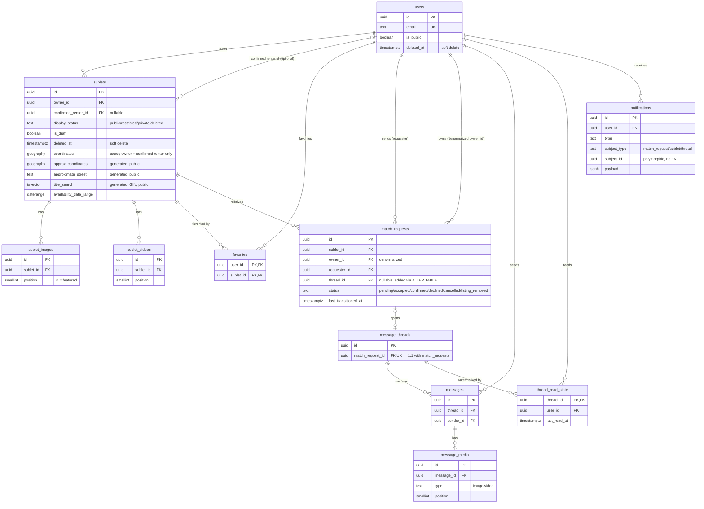

# SubletNU — Entity Relationship Diagram

Reflects `schema.sql` as of 10/27/26 (through migration
`1793155578946_add-public-rent-sort-index`). The ERD lists keys, status columns and the
location columns whose visibility differs; other columns are in `schema.sql`.
Built by `db/migrations/` locally and in CI; no deployed database yet.

`public_sublets` (a view, not drawn) is `sublets` restricted to public rows and
public-safe columns: `approximate_street` and `approx_coordinates` instead of
`street_address` and `coordinates`. Public reads go through the view; exact
location is for the owner and confirmed renter only.

`academic_calendar` (not drawn; no foreign keys) holds Northwestern Registrar
anchors. A listing's quarters are derived from its `availability_date_range`
and these anchors (`packages/shared/src/terms.ts`); the former
`sublet_quarters` table was retired in `1793123267633`.

## Notes the diagram can't fully express

- **`ON DELETE` policy**: every FK above is `RESTRICT` except `favorites`
  (both FKs `CASCADE`) — see `schema.sql`'s header comment for why favorites
  is the one deliberate exception.
- **`sublets.confirmed_renter_id`** is nullable and only meaningful when
  `display_status = 'restricted'` — it's what makes `'restricted'`
  ("visible to owner + confirmed renter only") different from `'private'`
  ("visible to owner only").
- **`match_requests.thread_id` ↔ `message_threads.match_request_id`** is a
  circular reference. `schema.sql` creates `match_requests.thread_id` as a
  plain nullable column with no inline FK, creates `message_threads`
  afterward, then adds `match_requests`' FK via a separate `ALTER TABLE`.
  The diagram shows the logical 1:1 relationship; the physical creation
  order is documented in `schema.sql` itself.
- **`notifications.subject_id`** is deliberately not a real foreign key —
  it's polymorphic (points into whichever table `subject_type` names), and
  Postgres can't enforce referential integrity across a polymorphic
  reference. Accepted risk, not an oversight — see EXPLAIN_BACK.md.
