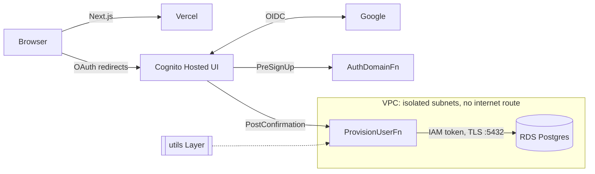
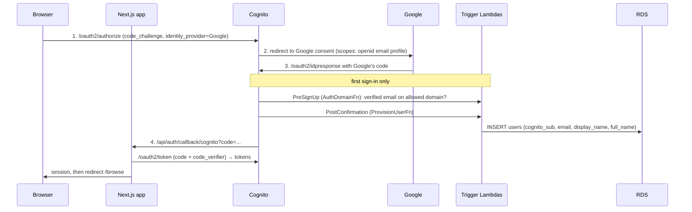

# Backend onboarding

`apps/backend/` holds the AWS CDK app (TypeScript), Lambda functions (Python 3.12), and the Postgres schema and migrations. Local DB setup and commands: `apps/backend/README.md`. Code conventions: `apps/backend/docs/conventions.md`.

## What exists today

| Piece | Where | Deployed? |
|---|---|---|
| Billing guardrails: SNS topic + 4 budgets | `lib/backend-stack.ts` → `BackendStack` | Yes |
| VPC (2 isolated subnets, no NAT) + RDS Postgres 17, db.t4g.micro | `lib/data-stack.ts` → `SubletNU-Data-<env>` | Not yet |
| Cognito user pool, Google IdP, app client, 2 trigger Lambdas, utils Layer | `lib/auth-stack.ts` → `SubletNU-Auth-<env>` | Not yet |
| Schema + migrations (node-pg-migrate, raw SQL) | `db/migrations/`, snapshot in `db/schema.sql` | Local docker + CI only |
| CI: typecheck, migrate up → down-all → up, jest DB tests | `.github/workflows/ci-backend.yml` | — |

Not built yet: API Gateway, the repository layer, and any Lambda that reads data for the frontend. The frontend's login/callback/session layer is built (see `frontend.md`).

## Architecture



## Auth flow (four hops)

Line-by-line walkthrough of every auth file, in request order (valid / expired / invalid JWT, logout), with a security map: [auth-walkthrough.md](auth-walkthrough.md).



- **AuthDomainFn** (`functions/auth/pre_sign_up.py`, no VPC, no DB). Fails closed: rejects if `ENVIRONMENT` is missing or unknown, the sign-up isn't Google, `email_verified` isn't `true`, or the domain isn't `northwestern.edu` or any subdomain like `u.`/`alum.` (prod), or exactly `gmail.com` (dev). Standard library only, so its zip holds just that one file.
- **ProvisionUserFn** (`functions/auth/post_confirmation.py`, in the VPC). Builds `display_name` from the email's local part (lowercased, trailing digits stripped, smallest free numeric suffix). Takes `full_name` from Google's `name` claim (or given + family), else NULL. Idempotent on `cognito_sub`, because Cognito retries.
- **utils Layer** (`functions/layer/python/`). Lambda extracts it to `/opt/python`, so functions write `from utils import get_db_connection`. Holds DB connection helpers, `avatar_initials`, and `rds-global-bundle.pem` (Amazon's public RDS root CAs) for `sslmode=verify-full`.
- Callback/logout URLs come from `ENVIRONMENT`: `http://localhost:3000/...` (dev), `https://sublet-nu.vercel.app/...` (prod). The callback is the code-exchange route, never `/browse`.

## Tests

| Tier | Where | Runs |
|---|---|---|
| 1: PreSignUp domain gate (pure) | `test/functions/test_pre_sign_up.py` | CI + `python -m pytest` (from `apps/backend`) |
| 1: PostConfirmation against local Postgres | `test/functions/test_post_confirmation.py` | CI. Locally needs `DATABASE_URL` (docker `db`) |
| 2: real sandbox Cognito + RDS (tokens, authorizer, IAM DB auth) | `test/integration/test_auth_sandbox.py` | Manual only: `SUBLETNU_SANDBOX=1` plus env listed in the file |
| 3: E2E route guards | `apps/frontend/e2e/auth.spec.ts` | Manual: `npm run test:e2e -w apps/frontend` |

Python test deps: `pip install -r apps/backend/requirements-dev.txt`. TypeScript DB tests: `npm test -w apps/backend` (jest).

## Deploying

**Region: every stack deploys to `us-east-2`** (`bin/backend.ts`, `env.region`). SSM parameters and Secrets Manager secrets are regional, so the Google credentials below must exist in us-east-2, as must the CDK bootstrap (`CDKToolkit`). All three are there today.

Prerequisites (one-time, per account):

1. SSM parameter `/subletnu/google-client-id` and Secrets Manager secret `subletnu/google-client-secret` (exact names, including the slash on the SSM one). Both exist in the account today.
2. CDK CLI `aws-cdk@^2.1147` (pinned in `apps/backend/package.json`). Older CLIs can't read manifests from `aws-cdk-lib@2.271`.
3. Python 3.12 + pip locally (assets bundle with `pip --platform manylinux2014_x86_64`; Docker is only a fallback).

```sh
cd apps/backend
npx cdk synth -c environment=dev -c alertEmail=you@example.com
npx cdk deploy SubletNU-Data-dev SubletNU-Auth-dev -c environment=dev -c alertEmail=...
```

After the first DB deploy, create the Lambda's Postgres role by hand. `rds_iam` exists only on RDS, so this can't be a migration:

```sql
CREATE ROLE app_user LOGIN;
GRANT rds_iam TO app_user;
GRANT SELECT, INSERT ON users TO app_user;
```

**Open gap:** RDS sits in isolated subnets, so there's no path yet for running migrations or `psql` from a laptop or CI. Options include a short-lived bastion, SSM port forwarding, or a migration Lambda. Not decided.

## Design choices and assumptions

| Choice | Why |
|---|---|
| Cognito, not NextAuth | Domain gate and user creation run inside the auth system, before any token exists. One token issuer for future APIs. No passwords stored (ADR 8) |
| No RDS Proxy yet | ~$11+/month for a pool we don't need at signup volume. Lambdas hit the instance endpoint directly. Revisit near the ~80-connection t4g.micro limit |
| Isolated subnets, no NAT | NAT is ~$33/month. The only Lambda in the VPC talks only to RDS, and IAM tokens are signed locally (no AWS API call) |
| IAM DB auth for Lambdas | No DB password in Lambda config. `rds-db:connect` is scoped to one DB user on one instance (`db-` resource ID) |
| Derivation logic in Python, not SQL | Inputs (Cognito claims) exist only in the trigger event, and the suffix rule needs a read first. Kept in one testable place. The DB still enforces the invariant: `UNIQUE(display_name)` |
| Derived fields never stored | `avatarInitials` is computed on read from `full_name`/`display_name`, so edits can't leave it stale |
| `users.display_name` UNIQUE + check-then-insert | Concurrent sign-ups with the same base name can race. The constraint turns that into a logged provisioning failure, not a duplicate. Accepted gap, no locking |
| `email` attribute immutable | The stored email is the Google-verified one; users can't change it. Cognito rewrites mapped attributes only when the value changes, so only a user whose Google email itself changes would be blocked from signing in |
| `allowTo` instead of `dbInstance.connections.allowFrom` | Same SG-to-SG rule, but it's created in the Auth stack. `allowFrom` creates a Data↔Auth dependency cycle |
| `restrictDefaultSecurityGroup: false` | `true` adds a custom-resource Lambda with a never-expiring log group. Nothing uses the default SG |

## Security posture (audited 11/01/26)

| Control | Where | Why |
|---|---|---|
| DB TLS `verify-full` + RDS CA bundle | `utils.get_db_connection` | `require` encrypts but never checks the server cert, so an impostor inside the VPC could collect IAM tokens. RDS on PG 17 also forces SSL server-side (`rds.force_ssl=1` default) |
| No DB error text in logs | `post_confirmation.py` | Postgres messages can include the failing row (emails, names). Only `pgcode` / constraint name is logged |
| App client: only `ALLOW_REFRESH_TOKEN_AUTH` | `auth-stack.ts` (`authFlows: { userSrp: false }`) | The default also enables SRP and custom auth; this pool has no passwords, so those are pure attack surface |
| Token revocation on, user-existence errors hidden | `enableTokenRevocation`, `preventUserExistenceErrors` | Logout revokes the refresh token; no account enumeration |
| `accountRecovery: NONE` | user pool | No passwords exist to recover |
| `deletionProtection` (prod) | user pool | The pool holds every `users.cognito_sub` mapping; deleting it orphans every account |
| Trigger invocation scoped | CDK-generated `AWS::Lambda::Permission` | `cognito-idp.amazonaws.com` with `SourceArn` = this pool only |
| Token lifetimes | app client | access 1 h, ID 1 h, refresh 5 days |
| Region pinned to `us-east-2` | `bin/backend.ts` | Regional secrets and the CDK bootstrap live there; `cdk.context.json` caches the AZ lookup (commit it) |
| No local junk in Lambda zips | `auth-stack.ts` `PACKAGING_JUNK` | `__pycache__`, `*.pyc`, `.DS_Store` from local runs never ship |
| CA bundle committed | `.gitignore` exception | `*.pem` would otherwise drop it from git; CI deploys from a clean checkout and `verify-full` would fail every DB connection |

Known, accepted: `npm audit --omit=dev` still lists `aws-cdk-lib`'s bundled `minimatch`/`brace-expansion` (DoS in glob parsing). They run only at synth time on a developer/CI machine, never in a deployed Lambda or page, and there's no upstream fix yet.

## Monthly cost (us-east-2, on-demand, when Data + Auth are deployed)

us-east-2 (Ohio) list prices match us-east-1 for these services; re-check in the AWS Pricing Calculator before deploying.

| Resource | ≈ $/month |
|---|---|
| RDS db.t4g.micro single-AZ (730 h × $0.016) | 11.68 |
| RDS gp3 20 GiB | 2.30 |
| RDS master-credential secret (Secrets Manager) | 0.40 |
| Backups (7 days, ≤ DB size) | 0 |
| Cognito (Lite tier, < 10,000 MAU) | 0 |
| Lambdas + Layer (signups only) | ~0 |
| CloudWatch Logs (2 groups, 7-day retention) | ~0 |
| **Total** | **~14.40** |

Only one environment is deployed at a time. Deploying `dev` and `prod` together would double the RDS lines (~$29/month).

CloudWatch Logs: log groups themselves are free. Ingestion is $0.50/GB and storage $0.03/GB-month, with 5 GB/month free. Trigger logs are ~1 KB per sign-up, so ≈ $0. Lambda writes these logs whether or not the groups are declared; declaring them only adds the 7-day retention.
