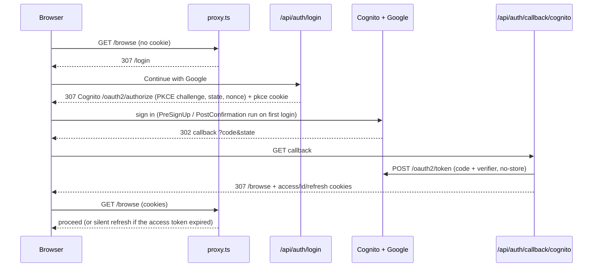

# Frontend onboarding

`apps/frontend/`: Next.js 16.4 (App Router), React 19, TypeScript, Tailwind v4, shadcn/ui, Vitest. Hosted on Vercel Hobby (ADR 4). Next 16 differs from older versions; read `node_modules/next/dist/docs/` before using an API (e.g. `middleware.ts` is now `proxy.ts`: `01-app/01-getting-started/16-proxy.md`).

## Local setup

`.env.local` lives at the repo root (`sublet_nu/.env.local`), not inside `apps/frontend/`. Next.js only loads `.env.local` from its own project root (the directory containing `next.config.ts`) and does not search parent directories. Since `apps/frontend/` is that project root, the root-level `.env.local` is invisible to `next dev` unless something bridges the two locations.

This repo bridges them with a symlink, not a copy, so there is exactly one file and nothing to drift out of sync. After cloning, run from the repo root:

```bash
ln -s ../../.env.local apps/frontend/.env.local
```

Verify it took with `ls -la apps/frontend/.env.local`: it should show as a symlink (`l` at the start of the permissions) pointing at `../../.env.local`, not a regular file. `next dev` only reads `.env.local` at startup, so restart the dev server after creating the link if it was already running.

## What exists today

- Every v1 page, built on **mock data** (`app/lib/mock-data.ts`). No page reads the backend yet.
- **Real Cognito sessions** guard every route except `/`, `/login`, `/robots.txt` and the `/api/auth/*` handlers (see Auth below). Ownership logic still uses the mock `CURRENT_USER_ID = 'user-jon'` until the repository layer exists (Day 6).
- **Crawlers:** `app/robots.ts` serves `Disallow: /` for every user agent (advisory; the login wall is the real control).
- **S3 images (planned)** load from the bucket's own domain and never pass through `proxy.ts`. Protect them with a private bucket + presigned URLs issued after `requireSession()`; if routed through `next/image`, restrict `images.remotePatterns` to the bucket and don't optimize presigned URLs (see auth-walkthrough §3.1).
- Shared domain types come from `packages/shared`, re-exported through `app/lib/definitions.ts`.

## Structure

| Path | Holds |
|---|---|
| `app/(all_pages)/` | All routes. `login/` and `(logged_in)/` (browse, sublet, profile, plus the `(_dashboard)` group). `/signup` redirects to `/login` (`next.config.ts`) |
| `app/api/auth/` | `login`, `callback/cognito`, `logout` Route Handlers |
| `app/lib/auth/` | Session building blocks: `config`, `tokens`, `cookies`, `cognito`, `pkce`, `session`, `login-errors` |
| `app/lib/dal.ts` | `verifySession` / `requireSession` / `getSessionUser` (server-only) |
| `app/actions/` | Server Actions (each calls `requireSession()` first) |
| `proxy.ts` | Session gate before every matched request |
| `app/components/` | Client components and UI pieces, grouped by feature |
| `app/lib/` | `definitions.ts` (types), `utils.ts`, `mock-data.ts`, address privacy helpers (`util-address.ts`) |

Rules: server components by default, small `'use client'` islands, and never pass another student's exact address to a client component (`toPublicSublet`). Details are in `.claude/plans/PLAN.md` §2.

## Auth

Line-by-line walkthrough of every auth file, in request order (valid / expired / invalid JWT, logout), with a security map: [auth-walkthrough.md](auth-walkthrough.md).



- **Cookies:** `subletnu-access`, `-id`, `-refresh` (and a 10-minute `-pkce`). All `HttpOnly`, `SameSite=Lax`, `Path=/`, `Max-Age` 5 days; `Secure` + `__Host-` prefix in production.
- **proxy.ts** (`app/lib/auth/session.ts` holds the logic): valid → proceed; expired → one refresh at `/oauth2/token`; bad signature or malformed → clear and redirect, never refresh.
- **Token verification** (`app/lib/auth/tokens.ts`): RS256 only. `iss` pinned to this user pool. Access tokens: `client_id` + `token_use: 'access'` pinned (Cognito access tokens have no `aud`; `client_id` is their audience). ID tokens: `aud` = this app client, `token_use: 'id'`, nonce at login. `exp`/`iat`/`sub` required. An expired token only counts as refreshable if it was for this client.
- **JWKS caching:** jose's `createRemoteJWKSet` keeps Cognito's public keys in memory per server instance (10 min, 3 s fetch timeout). It refetches early only for an unknown `kid` (key rotation), at most once per 30 s, so forged tokens can't trigger a fetch storm. This is a third cache, separate from Next's route-segment and `fetch()` caches; verification itself is local crypto (~sub-millisecond).
- **Matcher:** an explicit allowlist (`_next/static/`, `_next/image`, `favicon.ico`, `stock_images/`, the callback). Never "anything ending in .png": dynamic routes would skip auth for `/profile/<id>.png`. New public assets go in `public/stock_images/` or get added to the matcher.
- **Never cached:** every auth Route Handler response and every proxy redirect/refresh sends `Cache-Control: no-store`.
- **Security headers** (`next.config.ts`): `X-Frame-Options: DENY` + CSP `frame-ancestors 'none'; base-uri 'self'; object-src 'none'`, `nosniff`, `Referrer-Policy: strict-origin-when-cross-origin`, `Permissions-Policy`, HSTS. No script CSP yet (Leaflet needs a nonce-based policy).
- **Next.js 16.4.6 pinned.** 16.0–16.4.0 have Proxy-bypass advisories (dynamic route parameter injection, segment-prefetch routes) that would defeat `proxy.ts`; ≤16.4.4 also has a `use cache` data-leak advisory. Keep `next` and `eslint-config-next` pinned together.
- **Proxy is not the only gate.** Server Actions are reachable by direct POSTs the matcher may never see. Every Server Action calls `requireSession()` itself (`apps/backend/docs/conventions.md`).
- **Errors** reach `/login?error=<code>` from a fixed list (`login-errors.ts`); query text is never rendered.
- **Env:** `COGNITO_DOMAIN`, `COGNITO_CLIENT_ID`, `COGNITO_USER_POOL_ID`, `COGNITO_REGION`, `APP_URL` (`.env.example`; values from the `SubletNU-Auth-<env>` outputs). Missing values make protected routes fail closed (500). Getting "`COGNITO_DOMAIN` is not set" with the values in the root `.env.local`? See [Local setup](#local-setup).
- **Tests:** `__tests__/auth/` (Vitest, node env): proxy branches, callback cookies/redirect/CSRF/PKCE/nonce, logout, Server Action. `e2e/auth.spec.ts` (Playwright) for the route guards. Playwright 1.64 has no Chromium build for macOS 13.
- Display: `getSessionUser()` verifies the ID-token cookie (signature, `iss`, `aud`, same `sub` as the access token) and feeds the dashboard sidebar; initials via `avatarInitials` in `packages/shared`.
- **Tests:** also `__tests__/auth/audit-regressions.test.ts`: matcher coverage, other-pool / other-client / wrong-`token_use` / no-`exp` / HS256 tokens, no-store.
